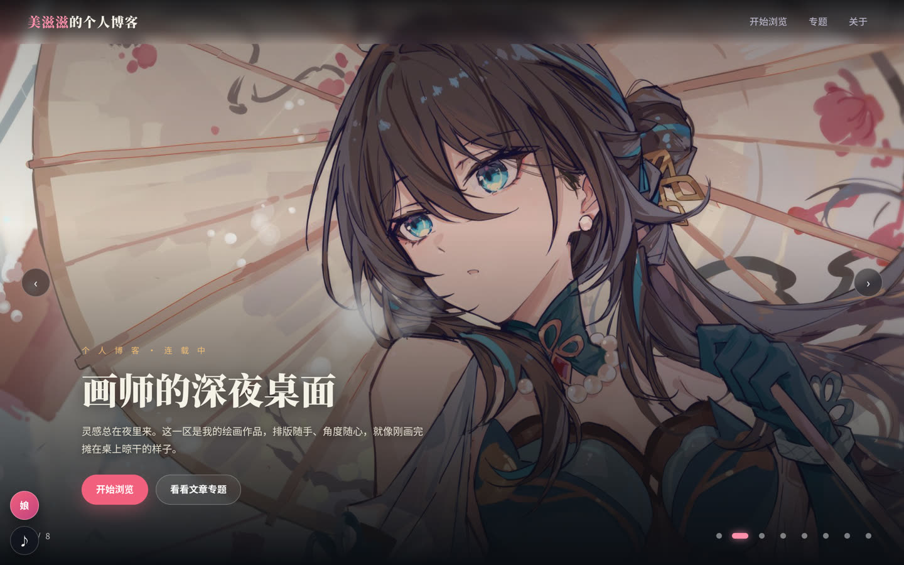
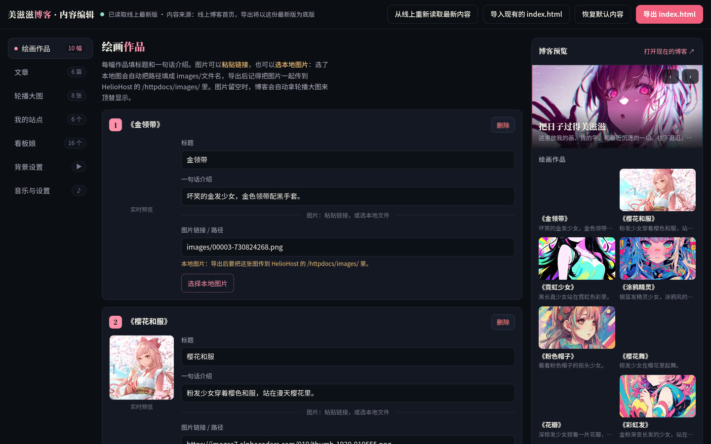

# 美滋滋的个人博客

我的个人博客：绘画作品展示、AI 短文、Live2D 看板娘、音乐播放器，全部在一个静态页面里，不用数据库，不用后端。

在线演示：[博客首页](https://leelokhan.github.io/meizizi-blog/) · [内容编辑器](https://leelokhan.github.io/meizizi-blog/editor/)

示例站：[博客首页](http://jiaguwensi.ct8.pl/) · [内容编辑器](http://jiaguwensi.ct8.pl/editor/)





[](https://deploy.cloudflare.com/?url=https://github.com/Leelokhan/meizizi-blog)
[](https://vercel.com/new/clone?repository-url=https://github.com/Leelokhan/meizizi-blog)
[](https://app.netlify.com/start/deploy?repository=https://github.com/Leelokhan/meizizi-blog)

## 里面有什么

- **绘画作品**：10 幅作品，随机排版、滚动随机飘入、悬停放大
- **文章**：6 篇 AI 相关短文，点开弹窗看全文
- **轮播大图**：顶部 8 张二次元大图，可自动/手动切换
- **Live2D 看板娘**：16 个碧蓝航线模型，点“换一个”切换，透明底、可拖动
- **音乐播放器**：网易云专辑，播放/切歌/循环/随机
- **背景视频**：初音短片循环（本地 `bg.mp4`，加载失败自动回退远程地址）
- **我的站点**：底部链接区，6 个自己的小站
- **内容编辑器**：打开 `editor/` 就能可视化改作品、文章、轮播图、链接、看板娘、背景，不用改代码

## 目录结构

```
├── index.html          # 博客首页（全部内容都在顶部 CONFIG 数据块里）
├── bg.mp4              # 背景视频（720p 循环短片）
├── images/             # 1 张本地作品图（示例）；其余 9 幅作品用外部图片链接，不占仓库空间
├── live2d/models/      # 16 个 Live2D 模型
├── editor/
│   └── index.html      # 可视化内容编辑器
├── docs/
│   └── screenshots/    # README 用的截图（博客首页、编辑器）
```

## 一键部署

点上面三个按钮任意一个，按提示登录、选仓库、部署，不用填任何配置就能上线。三个都是免费额度，静态站够用：

| 平台 | 要点 |
| --- | --- |
| Cloudflare Pages | 点按钮 → 授权 GitHub → Create，自动部署；送 `*.pages.dev` 域名，可绑自己的域名 |
| Vercel | 点按钮 → 授权 GitHub → Deploy；送 `*.vercel.app` 域名 |
| Netlify | 点按钮 → 授权 GitHub → Deploy；送 `*.netlify.app` 域名 |
| GitHub Pages | 推到 GitHub 后自动部署（分支部署），地址是 `https://<你的用户名>.github.io/meizizi-blog/`；想用根域名可以把仓库名改成 `<你的用户名>.github.io` |

## 任意服务器 / 虚拟主机

纯静态文件，不挑服务器：把整个仓库的文件拷到网站根目录（比如 HelioHost 的 `/httpdocs/`、Nginx / Apache 的站点目录）就能打开。不需要 Node.js、PHP、数据库。

## 自己改内容

两种办法：

1. **可视化编辑器**：打开 `你的域名/editor/`，打开就自动读取当前线上首页来改，改完点“导出 index.html”，把导出的文件传到网站根目录覆盖 `index.html`。
2. **直接改代码**：打开 `index.html`，只改顶部 `CONFIG` 数据块里的作品、文章、轮播图、链接、看板娘模型和专辑 ID。

新图片放到 `images/` 里（或直接填外部图片链接，像现在作品区这样），新模型放到 `live2d/models/` 里，路径写相对路径就行。

## 怎么改博客名字

博客名字会显示在两个地方：每次打开时的开场动画，和左上角导航栏。改名字有两个办法，改完效果一样：

**方法一：用编辑器改（推荐，不用碰代码）**

1. 打开你部署好的编辑器，比如 `你的域名/editor/`
2. 点左侧最后一个标签 **音乐与设置**
3. 找到 **站点名称** 那个输入框，把里面的字改成你的博客名字
4. 点右上角 **导出 index.html**，把导出的文件传到网站根目录，覆盖原来的 `index.html`，刷新就生效了

**方法二：直接改代码**

1. 打开 `index.html`，找到顶部 `CONFIG` 数据块里的这一行：

   ```js
   "siteName": "美滋滋的个人博客",
   ```

2. 把引号里的 `美滋滋的个人博客` 改成你的名字，保存，传到网站根目录覆盖原来的文件就行。

> 注意：改名字只改显示的文字，不用改文件名、不用改域名，链接和看板娘都不受影响。

## 说明

- Live2D 模型来自《碧蓝航线》，仅作个人博客装饰使用。
- 音乐播放器通过网易云公开接口取歌单，专辑 ID 在 `CONFIG` 里可换。
- 顶部轮播大图来自网络图床，加载失败会自动跳到下一张。
